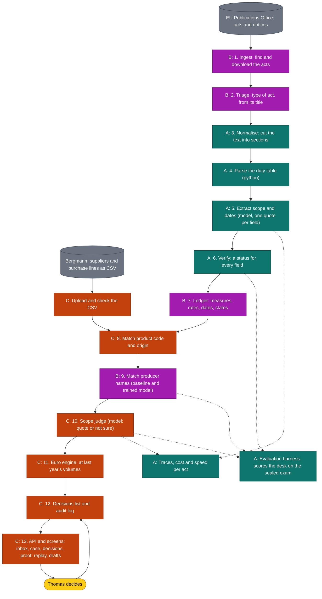

# 04 Architecture

How the parts fit together. One repository, one database, one command per run.

## The diagram, coloured by lane

- **Teal:** lane A, extraction and platform.
- **Magenta:** lane B, data and matching.
- **Orange:** lane C, product and decisions.
- **Grey:** things outside our code. **Yellow:** a person.
- **Solid arrows:** the path of one act. **Dotted arrows:** measurements.
- Each box starts with its lane letter. The numbers give the order of the steps.

An act zigzags between the lanes on purpose. Lane B fetches it, lane A reads it, lane B
stores the result, lane C shows it. The lanes meet only through agreed data shapes
(see "the contracts" below).

## The eight product steps and the numbered boxes

[01_PRODUCT.md](01_PRODUCT.md) tells the work in eight steps, as Thomas sees it. The
diagram cuts it into 13 numbered boxes, as we build it. Three more boxes have no number,
because they are not steps of one act: the upload, the traces and the evaluation.

| Product step | Boxes in the diagram |
|---|---|
| 1 Fetch the act | 1 |
| 2 Recognise the type of act | 2 |
| 3 Read the duty table | 3, 4 |
| 4 Read scope and dates | 5 |
| 5 Check every field | 6, 7 |
| 6 Match with Bergmann's lines and producers | 8, 9, 10, 12 |
| 7 Compute the euros | 11 |
| 8 Write tasks and drafts | part of 13 (a Should item, C-11) |

## The same thing as a list

| # | Part | Lane | Takes in | Gives out | How |
|---|---|---|---|---|---|
| 1 | `ingest` | B | a date window | the raw text of each act, stored unchanged with a fingerprint | a query to the EU's catalogue, then a download |
| 2 | `triage` | B | the title | the type of act | fixed rules on the title |
| 3 | `normalise` | A | raw text | title, recitals, articles, annexes, each paragraph with an id | Python (`lxml`) |
| 4 | `parse_tables` | A | the duty table | one row per code: kind of row, rate, all names in the row | Python, no model |
| 5 | `extract_llm` | A | the operative part and the annexes | products, codes, origins, stage, dates, which older act it changes; a quote for every field | `gpt-oss-120b` on Groq, typed output through PydanticAI |
| 6 | `verify` | A | the extraction and the text | a status per field | quote search, value inside its quote, code list lookup, parser against model |
| 7 | `ledger` | B | checked extractions | measures with rates, names, products, events and dates | SQL views or a Python build step |
| | `importer` | C | a CSV upload | checked suppliers and purchase lines | Pydantic |
| 8 | `match_product` | C | purchase lines and the ledger | in scope, out of scope, or unsure | product code and origin |
| 9 | `match_name` | B | the producer on the line and the names in each row | a tier and a score per pair | `rapidfuzz` spelling score, then logistic regression or a random forest |
| 10 | `scope_judge` | C | a line that might be covered, and the act's product description | outside scope, inside scope, or not sure; with a quote | `gpt-oss-120b` on Groq; a person confirms |
| 11 | `exposure` | C | matches, decisions, assumptions | a euro range | Python, ported from the prototype |
| 12 | `decisions` | C | open questions from all steps | one list; answers with a reason; log entries | database and API |
| 13 | `api`, `ui` | C | all tables | the screens | FastAPI, and the prototype's HTML and JS |
| | `observability` | A | every model call | traces, tokens, cost and time per call | Langfuse and SQL |
| | `evaluation` | A | system output and hand-written answers | the results table | Python |

Every step writes its result and one `run_event` row to the database. The replay plays
those rows back.

## Where the lanes meet: the contracts

A contract is a data shape that two lanes agree on. Lanes meet only through contracts, so
each person can build and test alone. All are frozen on **Thu 26 Nov**.

| Contract | Made by | Used by |
|---|---|---|
| `Act` (the raw act and its data) | B | A |
| `ActSection` (the act cut into parts) | A | A, C (highlighting) |
| `ActExtraction`, `FieldCheck` | A | B (ledger), C (case page) |
| `Measure`, `MeasureRate`, `CompanyAlias`, `MeasureProduct`, `MeasureEvent` | B | C |
| `Supplier`, `PurchaseLine` (the CSV format) | C | B (generator), C (matching) |
| `NameMatch` (tier, score) | B | C |
| `ScopeJudgement` (verdict, quote) | C | C (case page), A (report) |
| `Decision`, `AuditEvent` | C | all |
| `RunEvent` (step, status, detail, milliseconds) | all steps | C (replay) |

Until the real producer of a contract exists, everyone works from example files
(fixtures) made from two real acts: 2026/2393 and 2026/2311.

## Four ways to run it

| Mode | What happens | Used for |
|---|---|---|
| backfill | 24 months of acts. First only downloaded. Extraction starts after the sealed exam is drawn, and skips the exam acts. | weeks 1 and 2 |
| daily | a scheduled job fetches and processes what was published | from week 3 |
| replay | the screens play back stored run events at a chosen speed, marked "replay" | the presentation |
| live | one act runs with real model calls, no cache | the live part of the presentation, and the one exam run |

The commands: `tdd backfill`, `tdd daily`, `tdd replay`.

## The API, first cut

| Path | Purpose |
|---|---|
| `GET /health` | is it alive; used by the check after each deploy |
| `GET /acts`, `GET /acts/{celex}` | acts with type, status and field checks |
| `GET /acts/{celex}/text?section=` | text with paragraph ids, for highlighting a quote |
| `GET /cases`, `GET /cases/{id}` | the inbox, and one case with its six answers |
| `GET /decisions?open=true`, `POST /decisions` | the decisions list; an answer with a reason |
| `POST /importer/upload` | CSV upload, with errors per row |
| `GET /cases/{id}/exposure` | the euro range, the assumptions and the maths |
| `GET /cases/{id}/evidence` | the proof export |
| `GET /audit` | the log |
| `GET /runs/{id}/events` | stored run events for the replay |

## Where it runs

- **On a laptop:** Docker Compose with two services, `api` (which also serves the screens)
  and `postgres`.
- **Online:** Render, with one web service and one managed database. The daily job runs in
  GitHub Actions. The free-tier limits are `[VERIFY]`.
- **After every deploy:** a check calls `/health`, `/acts` and one case page. If one
  breaks, the release fails.
- **Data:** public acts and a synthetic importer. Nothing else is ever uploaded.
