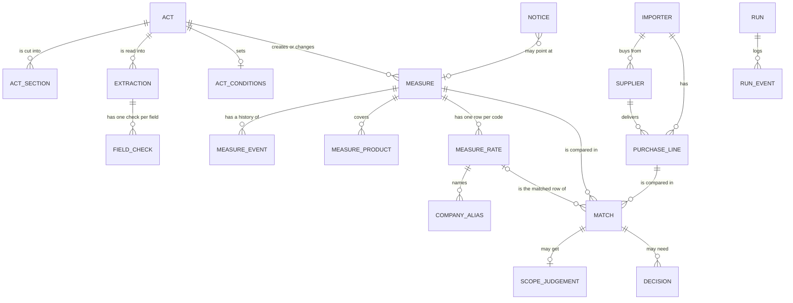

# 05 Data schema: the ledger and everything around it

One Postgres database holds everything. This page explains each table in plain words.
The exact Python shapes are frozen on Thu 26 Nov (issue X-04), so column names here can
still change until then.

## The picture

Four groups: **acts** (what the EU published), **measures** (the ledger itself),
**importer** (Bergmann's side), and **matching and decisions** (where the two meet).

## Group 1: the acts

### `act`: one row per published act

| Column | Meaning | Example |
|---|---|---|
| `celex` (key) | the EU's id of the act | `32026R2393` |
| `title` | the full title | "... imposing a definitive anti-dumping duty ... PET Spunbond ..." |
| `act_type`, `type_confidence` | what kind of act, from triage | `definitive`, high |
| `oj_ref` | where it was published | OJ L, 2026/2393 |
| `date_document`, `date_publication` | signed on, published on | 2026-10-29, 2026-10-30 |
| `applicable_from` | the day the rules start to apply | 2026-10-31 |
| `language`, `source_url` | which language version, and where from | `eng` |
| `sha256`, `bytes`, `fetched_at` | fingerprint, size and time of the download | 232,083 bytes |
| `is_holdout_hidden` | true while the act belongs to the sealed exam | false |

### `act_section`: the act cut into parts

One row per part: `celex`, `section_id`, `kind` (title, recital, article or annex),
`order`, `text`. A quote always points at a `section_id`, so the screen can highlight it.

### `notice`: short announcements

Notices start investigations and reviews. One row each: `celex`, `title`, `date`,
`notice_type` (initiation, expiry review, interim review, impending expiry, expiry, other)
and `linked_measure`, which is empty until a notice is linked to a measure.

### `extraction`: one reading of an act by one system

| Column | Meaning |
|---|---|
| `id` (key), `celex` | which act |
| `system` | who read it: `parser`, `llm` or `combined` |
| `provider`, `model`, `prompt_version` | exactly which model setup |
| `payload` | the extracted facts, as JSON |
| `tokens_in`, `tokens_out`, `cost_eur`, `latency_ms` | what the reading cost and how long it took |

### `field_check`: the verifier's verdict on one field

`extraction_id`, `field_path` (which field), `status` (checked by program, quote found,
not verified, failed), `quote`, `section_id`, `detail`.

### `llm_cache`: answers we already paid for

The key is the act's fingerprint plus the prompt version plus the model. The same question
is never sent twice.

### `act_conditions`: the fine print of one act

One row per act, each answer with its quote.

| Column | Meaning |
|---|---|
| `celex` | which act |
| `invoice_declaration_required`, `invoice_declaration_quote` | does the company rate need a signed declaration on the invoice, and with which words? |
| `provisional_collection_quote` | what happens to the amounts secured under the provisional duty |
| `retroactive_collection_quote` | is anything collected backwards in time? |
| `new_exporter_clause` | can producers that were not exporting yet be added later? (Article 3 of 2026/2393 is such a clause.) |
| `registration_celex` | the registration act this one refers to |

## Group 2: the measures (the ledger)

### `measure`: one card per duty on one product from one country

| Column | Meaning | Example |
|---|---|---|
| `measure_id` (key) | our own id | |
| `kind` | `AD` (anti-dumping) or `CVD` (anti-subsidy) | `AD` |
| `stage` | `registration`, `provisional` or `definitive` | `definitive` |
| `product_text` | the product in the act's words | "certain non-woven needle-punched sheets of polyester filaments ..." |
| `origin_countries` | where the goods are made | China |
| `liability_basis` | does the duty follow the `origin`, or the country of `consignment`? | `origin` |
| `extends_measure_id` | for an extension: which measure it stretches | empty |
| `legal_act_celex` | the act that set this stage | `32026R2393` |
| `valid_from`, `valid_from_basis` | start date, and where we read it | 2026-10-31 |
| `valid_to`, `valid_to_basis` | end date, only if an act or notice states it; the basis says `stated`, `expected_5y`, `provisional_max` or `unknown` | empty, `expected_5y` |
| `status` | `in_force`, `under_review`, `suspended`, `registered_only`, `expired`, `repealed`, `superseded` | `in_force` |
| `superseded_by` | the measure that replaced this one | |
| `has_open_event`, `needs_review` | flags that put a warning next to the euro figure | false |

### `measure_rate`: one row of a duty table

One row per measure and TARIC additional code.

| Column | Meaning | Example |
|---|---|---|
| `rate_id` (key), `measure_id` | | |
| `origin_country` | | China |
| `taric_additional_code` | the code of this row | `88CB` |
| `rate_category` | kind of row, see below | `individual` |
| `rate_pct` | the rate, when it is a simple percentage | 39.8 |
| `amount`, `unit`, `currency`, `formula_text` | for rates that are not a percentage (shown, not applied) | empty |
| `basis` | the price the rate applies to, as the act words it | "net, free-at-Union-frontier price, before duty" |
| `valid_from`, `valid_to`, `needs_review` | | |

The five values of `rate_category`:

| Value | Meaning | In the fleece act |
|---|---|---|
| `individual` | a rate for one named producer or group | 39,8 % and 48,1 % |
| `cooperating_not_sampled` | the shared rate of the producers in the annex | 47,1 % |
| `residual` | "all other imports" | 48,1 % |
| `country_wide` | one rate for a whole country, no company rows | not used; see example 08 |
| `undertaking` | a price promise instead of a duty | not used; stays empty in our four weeks |

### `company_alias`: every name written in a row

`rate_id`, `name`, `city`, `role` (producer, exporter or related). A grouped cell gives
several names for one `rate_id`.

### `measure_product`: the product codes a measure covers

`measure_id`, `cn_code`, `is_ex_code`, `taric_code` (may be empty).

### `measure_event`: what happened to a measure later

`measure_id`, `celex`, `event_type` (review started, extended, amended, suspended,
reinstated, repealed, corrected, undertaking accepted or withdrawn, expiry notice),
`effective_date`, `quote`, `needs_review`.

### `undertaking` and `exempted_company`

Both exist so the schema can hold the real legal situations. Both stay empty in our four
weeks.

## Group 3: the importer

### `importer`, `supplier`

`importer(id, name)` and `supplier(id, importer, name, city, country)`.

### `purchase_line`: one product from one supplier

| Column | Meaning | Example `[INVENTED]` |
|---|---|---|
| `id`, `importer`, `supplier` | | L01, Bergmann |
| `description` | the goods in the importer's words | "Root-barrier fleece, 180 g/m2, 1.2 mm" |
| `cn_code`, `taric_code` | product codes; the TARIC code may be missing | `5603 14 80`, `5603 14 80 70` |
| `origin`, `country_of_dispatch` | made in, sent from | China, China |
| `producer_name` | the producer named on the invoice | "Hubei Unibon Non-Woven Co., Ltd." |
| `invoice_declaration_present` | is the signed declaration on the invoice? | yes |
| `annual_customs_value_eur` | last year's purchases, as customs value | 400,000 |
| `net_weight_kg`, `quantity`, `quantity_unit` | amounts | |
| `incoterm` | the delivery terms of the contract | FOB |
| `in_transit_value_eur` | shipped but not yet released | 36,000 |

## Group 4: matching and decisions

### `match`: one purchase line against one measure

`purchase_line`, `measure`, `product_status` (in scope, out of scope, unsure),
`matched_rate` (which row of the duty table), `name_tier`, `name_score`, `needs_decision`.
The producer is matched, not only the supplier.

### `scope_judgement`

`match`, `verdict` (excluded, not excluded, abstain), `quote`, `model`, `created_at`.

### `decision`: what a person settled

`match`, `question`, `answer`, `reason`, `decided_by`, `decided_at`.

### `audit_event`: the log

`id`, `ts` (time), `actor`, `kind`, `payload`. Nothing is ever deleted from it.

### `run`, `run_event`

`run(id, kind, started_at, finished_at)` with kind backfill, daily, replay or live.
`run_event(run, step, status, detail, ms)`: one row per step. The replay plays these.

## Six rules the ledger follows

1. **No computed end date.** `valid_to` is filled only when an act or a notice states a
   date. Otherwise the case says "in force, expected to run to DATE unless a review is open".
2. **Registration is a state, not a duty.** It reads "registered: duty may be collected
   later" and is never counted in the euro figure.
3. **A review keeps a measure alive.** A notice that opens an expiry review sets
   `under_review`. The measure stays in force while the review runs.
4. **Open events put up a warning.** Any later act or notice that mentions a measure sets
   `has_open_event`.
5. **Hard cases go to a person.** Amendments, corrections, suspensions, undertakings and
   rates that are not a simple percentage set `needs_review`. They are shown, not applied.
6. **An extension changes the test.** For a measure with `liability_basis = consignment`
   the origin test does not apply, so the line goes to a person.

## Who writes what

- The pipeline writes the act tables, and builds the measure tables from them.
- The API writes the importer, decision and audit tables.
- Lane A owns the shapes, lane B the ledger tables, lane C the importer and decision tables.

To see these tables filled with a real case, read
[examples/01_ONE_CASE_FOUR_DOCUMENTS.md](examples/01_ONE_CASE_FOUR_DOCUMENTS.md).
